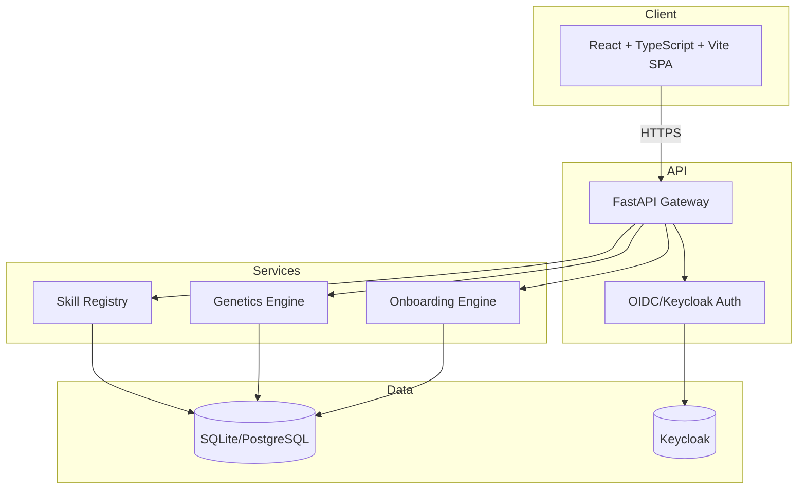

# Atlas Lab — Alan Vo | AI & Machine Learning

> Work in progress. This checkpoint may be incomplete or fail tests. See PLAN.md and STATUS.md before use.


Turn any AI agent into an AI Scientist. A platform for managing and executing scientific agent skills, with focus on statistical genetics and research field onboarding workflows.

## Problem

Scientific research increasingly relies on AI agents, but agents lack structured, validated skills for domain-specific workflows. Researchers need:
- **Statistical genetics workflows**: Colocalization analysis requires fetching GWAS/eQTL data, computing linkage disequilibrium, and rendering publication-quality locus compare plots.
- **Field onboarding**: When entering a new research area, agents should teach step-by-step from prerequisites to frontier, not dump specialist jargon.

## AI/ML Approach

This platform implements two substantive AI/ML workflows:

1. **Locus Compare Pipeline** (Statistical Genetics): A deterministic 4-stage pipeline that orchestrates GWAS Catalog fetch → eQTL Catalogue fetch → 1000 Genomes LD computation → harmonized 4-panel plot rendering. No LLM required; fully reproducible offline.

2. **Field Onboarding Engine** (Research Methodology): A structured teaching workflow that assesses prerequisites, classifies field maturity (settled/emerging/contested), climbs a fixed 5-rung ladder (motivation → vocabulary → framework → methods → frontier), and decodes passages by separating source claims, background, inferences, and critique. Operates without network access; uses search tool when available for paper verification.

## Intended Users

- Computational biologists and statistical geneticists needing reproducible colocalization plots
- Researchers entering new fields who need structured onboarding
- AI agent developers building scientific skill libraries

## Architecture



## Quick Start

### Prerequisites
- Docker & Docker Compose
- Node 24 (for local frontend dev)
- Python 3.12 (for local backend dev)

### Docker Compose (Recommended)
```bash
# Copy environment template
cp .env.example .env
# Edit .env with your settings (optional for demo)

# Start all services
docker compose up -d

# Frontend: http://localhost:5173
# Backend API: http://localhost:8000
# API Docs: http://localhost:8000/docs
# Keycloak: http://localhost:8080 (admin/admin)
```

### Local Development

**Backend:**
```bash
cd backend
python -m venv .venv
source .venv/bin/activate
pip install -r requirements.txt
uvicorn app.main:app --reload --host 0.0.0.0 --port 8000
```

**Frontend:**
```bash
cd frontend
npm install
npm run dev
```

## Running Tests

**Backend:**
```bash
cd backend
source .venv/bin/activate
PYTHONPATH=backend python -m pytest tests/ -v
```

**Frontend:**
```bash
cd frontend
npm run typecheck
npm test
```

## API Reference

### Health
- `GET /api/v1/health` — Service health check
- `GET /api/v1/health/db` — Database connectivity

### Authentication (OIDC/Keycloak)
- `GET /api/v1/auth/login` — Initiate OIDC login
- `GET /api/v1/auth/callback` — OIDC callback (PKCE)
- `POST /api/v1/auth/logout` — Logout
- `GET /api/v1/auth/me` — Current user info

### Skills Registry
- `GET /api/v1/skills/` — List skills (with filtering/pagination)
- `GET /api/v1/skills/{id}` — Get skill details
- `POST /api/v1/skills/` — Create skill (operator/admin)
- `PUT /api/v1/skills/{id}` — Update skill (operator/admin)
- `DELETE /api/v1/skills/{id}` — Delete skill (admin)

### Statistical Genetics
- `GET /api/v1/genetics/gwas/region` — Fetch GWAS Catalog region
- `GET /api/v1/genetics/eqtl/region` — Fetch eQTL Catalogue region
- `POST /api/v1/genetics/ld/compute` — Compute LD from 1000 Genomes
- `POST /api/v1/genetics/locuscompare/render` — Render locus compare plot
- `POST /api/v1/genetics/locuscompare/workflow` — End-to-end workflow

### Field Onboarding
- `POST /api/v1/onboarding/assess` — Assess prerequisites & field maturity
- `POST /api/v1/onboarding/ladder/step` — Get ladder teaching step
- `POST /api/v1/onboarding/decode` — Decode passage (claims/background/inference/critique)
- `GET /api/v1/onboarding/session/{id}` — Get onboarding session

## AI/ML Evaluation

### Locus Compare Pipeline
**Baseline**: Manual colocalization analysis using standalone tools (LocusCompare, GWAS Catalog, eQTL Catalogue, PLINK/LDlink).
**Implemented**: Automated 4-stage pipeline with harmonization, palindromic variant exclusion (A/T·G/C), beta flipping for swapped alleles, 4-panel PNG output.
**Reproducible Command**:
```bash
curl -X POST http://localhost:8000/api/v1/genetics/locuscompare/workflow \
  -H "Content-Type: application/json" \
  -d '{"gene":"SORT1","tissue":"liver","outcome_trait":"triglycerides","population":"EUR","sentinel_snp":"rs12740374","window_kb":500}'
```
**Limitations**: Requires network access to GWAS Catalog, eQTL Catalogue, and 1000 Genomes FTP. LD computation limited to 1000 Genomes populations. No fine-mapping or conditional analysis.

### Field Onboarding Engine
**Baseline**: Ad-hoc agent explanations that assume specialist knowledge.
**Implemented**: Structured 5-rung ladder with prerequisite assessment, field maturity classification, diagnostic questions, term anchoring, and paper verification labels.
**Reproducible Command**:
```bash
curl -X POST http://localhost:8000/api/v1/onboarding/assess \
  -H "Content-Type: application/json" \
  -d '{"field":"statistical genetics","user_background":["molecular biology","Python"]}'
```
**Limitations**: No network access in core engine; paper verification requires host-provided search tool. Coverage thin outside physics/ML. No evaluation metrics yet.

## Security Limitations

- **Demo mode**: Default configuration uses demo tokens; production requires Keycloak with real OIDC credentials
- **No TLS termination**: Deploy behind reverse proxy (nginx/Traefik) with valid certificates
- **SQLite default**: Use PostgreSQL for production (set `DATABASE_URL`)
- **Secrets**: Never commit `.env`; use Docker secrets or vault in production
- **CORS**: Configure `CORS_ORIGINS` for your domain
- **LLM keys**: Server-side only via `LLM_API_KEY`; never expose to frontend

## Provider Configuration

| Provider | `LLM_PROVIDER` | `LLM_BASE_URL` | Notes |
|----------|----------------|----------------|-------|
| OpenAI | `openai-compatible` | `https://api.openai.com/v1` | Default |
| Anthropic | `anthropic` | `https://api.anthropic.com` | Messages API |
| Gemini | `gemini` | `https://generativelanguage.googleapis.com` | GenerateContent |
| Ollama | `ollama` | `http://localhost:11434` | Local |
| LiteLLM | `openai-compatible` | Your LiteLLM proxy | OpenAI-compatible |
| OpenRouter | `openai-compatible` | `https://openrouter.ai/api/v1` | Multi-provider |

Set `LLM_API_KEY` (required for LLM features), `LLM_MODEL`, and optionally `LLM_BASE_URL`.

## SSO/SAML Setup

Keycloak supports SAML 2.0 identity brokering for enterprise IdPs (Okta, Azure AD, PingIdentity, etc.):

1. In Keycloak Admin Console → Identity Providers → Add SAML v2.0
2. Configure IdP metadata (entity ID, SSO URL, certificates)
3. Map SAML attributes to Keycloak user attributes (email, name, roles)
4. Set First Login Flow to "first broker login" for account linking
5. Test with `docker compose logs keycloak`

Documentation: [Keycloak SAML Brokering](https://www.keycloak.org/docs/latest/server_admin/#_saml_v2_0_identity_providers)

## Backup & Restore

**Database (SQLite):**
```bash
# Backup
docker compose exec backend cp /app/data/atlas_lab.db /app/data/backup_$(date +%F).db

# Restore
docker compose exec backend cp /app/data/backup_2026-01-15.db /app/data/atlas_lab.db
```

**Database (PostgreSQL):**
```bash
# Backup
docker compose exec postgres pg_dump -U atlas_lab atlas_lab > backup_$(date +%F).sql

# Restore
docker compose exec -T postgres psql -U atlas_lab atlas_lab < backup_2026-01-15.sql
```

**Keycloak:**
```bash
# Export realm
docker compose exec keycloak /opt/keycloak/bin/kc.sh export --dir /opt/keycloak/data/export --realm atlas-lab
```

## Deployment Notes

- Bind ports to `127.0.0.1` in compose for local dev; use reverse proxy for production
- Healthchecks configured for all services
- Non-root users in Dockerfiles
- `.dockerignore` excludes `.venv`, `node_modules`, `dist`, `__pycache__`, `.env`, `*.db`
- CI builds images with `push: false` (no registry costs)

## License

MIT License — Copyright (c) 2026 Alan Vo <alanvo@gmail.com>

See [LICENSE](LICENSE) for details.

---

Alan Vo | alanvo@gmail.com | AI & Machine Learning